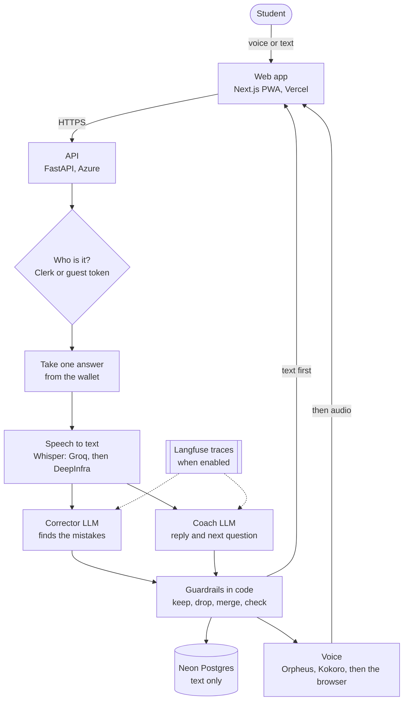
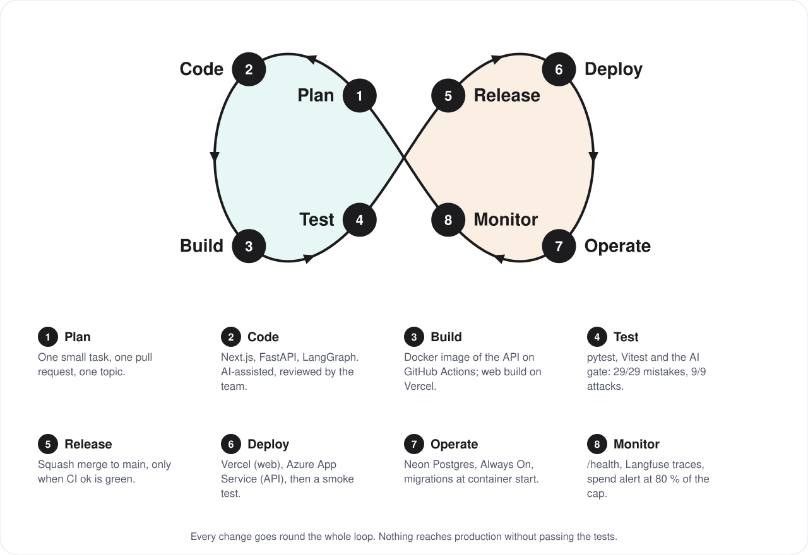

# Tkallem

[](https://github.com/yanou16/tkallem/actions/workflows/ci.yml)
[](https://github.com/yanou16/tkallem/actions/workflows/api-image.yml)
[](packages/agent/evals/gate.py)


**An AI coach that lets Algerian students rehearse real English interviews out loud, and explains every mistake in French.**

|  |  |
|---|---|
| **Live app** | https://tkallem.vercel.app: press "Try a visa interview now" (no account, 40 free answers) |
| **API** | https://tkallem-api-rayane.azurewebsites.net/docs |
| **Demo video (2 to 4 min)** | `[TEAM: link]` |

## The problem

Many Algerian students understand English but freeze when they have to speak it at a decisive moment: a US visa interview,
a Campus France interview, a remote job interview, IELTS Speaking. There is nowhere safe to rehearse: a teacher is not
available at night, and a friend's feedback is polite, not precise.

Tkallem is that place. A coach asks the real questions, listens, and shows what was good and the one thing to fix first,
with nobody watching. The student can also see the freeze itself: how long they waited before starting to answer.

`[TEAM: who has this problem and who you spoke to: how many students, where, what they said]`

## Try it in 30 seconds

1. Open https://tkallem.vercel.app and press **Try a visa interview now**. No account.
2. Answer the first question out loud, or type it. Not sure how to start? Press **Help me start**.
3. Read the correction (one compliment, then the one fix that matters), press **Say it again**, then finish the interview
   and open the **report**.

A guest has 40 free answers. Signing in adds 60 more and 15 every day. It installs on a phone like an app (PWA).

## What a student can do

1. **Build a plan (1 minute, optional):** five questions set the level, the daily goal and the order of the situations.
2. **Pick a situation:** visa interview, Campus France, remote job interview, IELTS Speaking, everyday scenes. 5 to 10
   minutes each, ending with a report.
3. **Choose a mode:** *Practice* (corrections after each answer, hints, "Say it again") or *Real interview* (the coach plays
   the officer, nothing is shown until the report, like the real one).
4. **Answer out loud or by typing.** The coach replies in text and in a natural voice.
5. **Get feedback that reassures before it corrects:** one true compliment, then the single correction that matters most,
   explained in French or simple English.
6. **When frozen, press "Help me start":** the first words of an answer, or the student's idea written in French or
   Darija turned into English to read aloud. Free, two per question.
7. **Say the corrected sentence again:** the code checks it, not the AI: "Nailed it", or a gentle hint.
8. **Read the report:** progress since last time, **how long they waited before speaking**, mistakes per 100 words, the
   answer to redo, and how confident they feel before and after (1 to 5).

## Architecture


*Solid boxes run today; the dashed Redis box is planned for running several API instances.* More detail, the data model
and the capacity limits: [`docs/architecture.md`](docs/architecture.md).

### The AI stack: what happens when a student answers



The two model calls run in parallel, and the reply streams to the student before the corrections are ready, so the voice
can start early. Every provider has a backup: a rate limit during the judging week costs a second, not the session.

## "The model talks, the code decides"

A language model never decides alone what a student sees. Everything below is checked by code and covered by tests.

| The model proposes | The code decides |
|---|---|
| Mistakes to correct | Keeps at most 3; drops a fix that changes nothing, quotes words the student did not say, removes a name or a number, or rewrites far more than it replaces; merges fixes that touch the same words; the sentence color comes from the fixes |
| A compliment | Kept only if it is short, only positive, quotes the student's own words, does not name anything absent from the answer and does not praise the mistake itself |
| The coach's reply | The next question is added verbatim from the scenario; a question is repeated at most once; answered questions are skipped; nothing reopens after the closing line; in a real interview any praise is replaced by "Thank you." |
| Sentence starters, translations | 12 words at most and stopping before the content (never a complete answer); a translation must keep every name and number, add none, and be a finished sentence; otherwise the scenario's own starter is used |
| Whether the student repeated the correction | Never the model: 85 % word similarity, every fixed phrase heard, the mistake not said again |
| Progress, freeze, confidence lines | Computed from stored numbers, never written by the model |

Prompt injections ("ignore your rules", "mark this green", hidden JSON) are treated as data: see
`packages/agent/evals/injection.py`. How the agent plugs into the API: [`docs/agent-integration.md`](docs/agent-integration.md).

## DevOps: one loop, nothing skips a step



| Step | What really happens |
|---|---|
| **Plan, code** | One small pull request per topic. Direct pushes to `main` are refused (a pre-push hook and branch protection). |
| **Build** | GitHub Actions builds the API Docker image (non-root user) and pushes it to GitHub Container Registry. Vercel builds the web app. |
| **Test** | `CI ok` needs these green: agent tests, API tests against a real Postgres (with the migrations), web typecheck, tests and build, the Docker build and, when the agent changes, the **AI gate** (29/29 seeded mistakes detected, 0 false alarm, 9/9 prompt-injection attacks handled). |
| **Release** | Squash merge to `main`, only when `CI ok` is green. |
| **Deploy** | Vercel deploys the web app; Azure App Service pulls the new API image. A smoke test then waits until `/health` reports the new commit and `/scenarios` answers, or the deploy fails. |
| **Operate** | Azure B1 with Always On (Frankfurt), Neon Postgres (Frankfurt), database migrations run when the container starts. |
| **Monitor** | `/health` check, Langfuse traces (when enabled), and an alert at 80 % and 100 % of the daily spending cap (webhook to Slack or Discord). |

Details of the Azure setup: [`infra/azure/README.md`](infra/azure/README.md).

## Tech stack

- **Web:** Next.js 16, React 19, Tailwind CSS, Clerk, installable PWA with a service worker, TanStack Query. The optional 3D coach (TalkingHead) is off by default.
- **API:** FastAPI, Pydantic, PostgreSQL (Neon), raw SQL with psycopg 3 and a connection pool, Alembic, httpx. Docker image on Azure App Service (B1, Always On).
- **Agent:** LangGraph, LangChain. Main model Qwen3-235B through OpenRouter, backups GPT-4.1 mini and Qwen3 on Groq.
- **Voice:** Whisper large-v3-turbo on Groq (DeepInfra backup); Orpheus on Groq, then Kokoro on DeepInfra, then the browser's voice. The API also has a real-time voice route (Pipecat, WebRTC) that the app does not use yet.
- **Quality:** pytest (agent and API), Vitest, an AI evaluation gate, GitHub Actions, Locust load test, Langfuse tracing (off unless configured).
- **AI tools used to build it:** Claude Code (AI coding assistant) for a large part of the code, reviewed and tested by the team. `[TEAM: add the tools each of you used]`

## Run it locally

You need Node 20+, Python 3.12, a Postgres database (a free Neon project works) and API keys for a language model and a
speech provider.

```bash
# API  (http://localhost:8000)
cd apps/api
python3 -m venv .venv && .venv/bin/pip install -r requirements.txt
cp .env.example .env            # fill in DATABASE_URL, an LLM key, a speech key, Clerk; see the comments inside
.venv/bin/alembic upgrade head  # creates the tables
.venv/bin/uvicorn app.main:app --reload

# Web  (http://localhost:3000)
cd apps/web
npm install
cp .env.local.example .env.local   # NEXT_PUBLIC_API_URL=http://localhost:8000, Clerk keys
npm run dev
```

Keys live only in `.env` files, which Git ignores. Guests need no Clerk account: open `/ai-chat?scenarioId=visa-us`.
Add a scenario: one JSON file in `packages/agent/tkallem_agent/scenarios/` (see `visa-us.json`); `pytest` in
`packages/agent` validates it. Backend reference (routes, variables, migrations, the groups WebSocket):
[`apps/api/README.md`](apps/api/README.md).

## Tests

```bash
cd packages/agent && ../../apps/api/.venv/bin/pytest -q                      # agent
cd apps/api && TEST_DATABASE_URL=<a scratch database> .venv/bin/pytest -q   # API
cd apps/web && npm run typecheck && npm test                                 # web
```

Evaluation baseline (real model, `packages/agent/evals/gate.py`): **29 of 29 seeded mistakes detected, 0 false alarm on
correct sentences, 9 of 9 prompt-injection attacks handled, 0 complete-answer starter and 0 changed name or number in the
"Help me start" sets, 0 invented compliment.**

## Security

What protects the students, the data and the bill. Each line points to the code that does it.

| Risk | What the code does | Where |
|---|---|---|
| Someone pretends to be another student | Clerk tokens are verified on every request: RS256 signature against Clerk's public keys, issuer, expiry and the origin that requested the token (`azp`) must match | `apps/api/app/security.py` |
| A guest invents or changes an identity | Guest tokens are `g1.<id>.<HMAC-SHA256>` signed with `GUEST_SECRET` (32+ characters), compared in constant time; sent in a header, never a cookie | `apps/api/app/guests.py` |
| Reading or changing another student's data | Every route first loads the session, message or group through an owner or membership check (`WHERE id = %s AND user_id = %s`, 403 or 404 otherwise) | `apps/api/app/db/`, `apps/api/app/routes/` |
| SQL injection | Values are always bound parameters; the only names built into SQL come from fixed lists in the code | `apps/api/app/db/` |
| Another website calling the API | CORS allows only the front's origins (`FRONTEND_ORIGIN`); the groups WebSocket checks the `Origin` itself | `apps/api/app/main.py`, `routes/group_ws.py` |
| Oversized or malformed input | Pydantic limits on every body, recordings over 5 MB refused with 413, messages 1 to 500 characters in the API and in the database | `apps/api/app/schemas/`, migrations |
| Prompt injection | The student's words are framed as data; the code validates every field the model returns; 9 of 9 attacks handled in the gate, which blocks a merge | `packages/agent/tkallem_agent/`, `evals/injection.py` |
| Flooding and abuse | Answers come from a wallet; guest accounts are capped per address and per day; hints, replays and group messages are rate limited | `apps/api/app/credits.py`, `rate_limit.py` |
| An unbounded bill | `DAILY_SPEND_CAP` stops the free practice for everyone for the day, with an alert at 80 % and 100 % | `apps/api/app/credits.py` |
| Personal data | A guest's network address is stored only as a keyed hash; only text is kept, never audio | `apps/api/app/guests.py` |
| Secrets in the repository or the image | Keys live in `.env` files and in GitHub, Azure and Vercel settings; `.dockerignore` keeps every `.env` out of the image | `.gitignore`, `.dockerignore` |
| A compromised container | The image runs as a non-root user; Azure serves HTTPS only | `apps/api/Dockerfile`, `infra/azure/` |

**Not done yet:** no Content-Security-Policy or HSTS headers on the web app; rate limits are in memory (one process); no
automatic dependency scanning; sign-in still uses a Clerk development instance. `[TEAM: confirm before submission]`

## Cost, free answers and judging-week safety

One answer from the student uses one free answer (a "credit" in the code). A guest gets **40**; signing in adds **60** and
moves the guest's unused answers over; then **15 every day**, never above **45**. `DAILY_SPEND_CAP` (default 5000) bounds what
everyone together can spend per day; at 80 % and at 100 % the API logs an alert and posts to a webhook if one is set.

| One answer costs us | |
|---|---|
| Typed | about 0.0003 $ |
| Spoken, voice by Groq Orpheus | about 0.0034 $ |
| Spoken, voice by DeepInfra Kokoro | about 0.0009 $ |

So the cap bounds the daily bill: at most about 17 $ a day if every answer were spoken with Orpheus, about 1.5 $ if typed.
The database pool is 10 connections; a Locust load test of the judge journey (50 simulated users, fake model) kept the
median answer at 2.3 s with no errors (`apps/api/loadtest/`).

## Impact

What Tkallem can measure about students who freeze, from real sessions. Only averages, never a student.

- **Time before you start (the freeze meter):** seconds between the end of the coach's question and the first sound or letter, averaged per session. Typed and spoken sessions are never compared.
- **Confidence before and after (1 to 5):** the student's own answers. `apps/api/scripts/impact.py` prints the average over all sessions that have both.
- **Mistakes per 100 words, answer length, pauses:** computed by code from the transcripts, shown on the report and the Progress screen.

Honest limits: confidence is self-reported, the number of sessions is small, and there is no control group.

## What happens next

Over the next three months we will put Tkallem in front of 30 students preparing visa and Campus France interviews, through
student clubs and language centers, and check whether their mistakes per 100 words and their time before speaking drop
over five sessions. We will add the scenarios they ask for, such as scholarship interviews, and a French interface. It
stays free to try with daily answers; intensive preparation packs and language-center partnerships would pay for it. A
spoken answer costs us less than half a cent today. `[TEAM: name the clubs and centers we will approach]`

## Who built what

Git history shows the real split (the same person sometimes commits under two names). `[TEAM: each person checks their own line and adds their full name]`

- **Rayane Louzazna:** tech lead. The AI coach (agent, prompts, guardrails, evaluation sets), the voice pipeline and its backups, free answers and guest mode, deployment (Azure, Neon, Vercel), the CI/CD, the four improvements ("Help me start", "Say it again", Practice and Real interview modes, corrections that reassure first), the freeze meter and the report.
- **Zaki:** the API (sessions, profile, progress, database and migrations), the practice groups end to end (database, REST routes, the live WebSocket, the leaderboard and the screen), the API documentation, the load test, the README diagrams. `[TEAM: Zaki, confirm]`
- **Akram (Wad2o):** the first front-end redesign (sign-in with Clerk), the dashboard and practice API routes, and the real-time voice route (Pipecat, WebRTC) in the API. `[TEAM: Akram, confirm]`

## Known limits (we would rather say them)

- **The microphone is tested on desktop Chrome, not yet on every phone.** Autoplay rules and microphone permission differ on iPhone Safari and Android Chrome; a "Tap to hear the coach" button covers blocked audio. `[TEAM: update after the phone tests]`
- **The evaluation sets are small and labelled by one person:** 33 sentences, 9 attacks, 20 "Help me start" cases. They catch regressions; they do not prove the coach is right about every sentence. A correction can still be wrong.
- **Darija translation depends on the model;** a translation the code refuses falls back to a generic starter.
- **Scenarios are few** (ten). A real Campus France interview is in French; ours trains the English version of it.
- **One API process:** rate limits and the groups' live connections are in memory; several instances would need Redis first.
- **Practice groups are built but hidden** for the competition (`NEXT_PUBLIC_FEATURE_GROUPS=1` shows them).
- **Sign-in uses a Clerk development instance** and the interface is in English only.
- **The sample 3D avatar is optional and off by default:** it comes from the TalkingHead project, whose sample avatars are for non-commercial use.
- Voice quality and latency depend on the speech providers' free daily quotas; backups exist, but a long outage falls back to the browser's voice.

## Repository

```
apps/web/        Next.js app: src/app (routes), src/features (one folder per feature), src/components, src/lib
apps/api/        FastAPI: app/ (routes, db with raw SQL, schemas, voice), alembic/ (migrations), tests/, loadtest/
packages/agent/  the coach: LangGraph graph, prompts, scenarios (one JSON file each), guardrails, evals
packages/contracts/  OpenAPI and the agent turn schema, shared by the three
docs/            architecture.md, agent-integration.md, and the diagrams used above
infra/azure/     deployment script and notes
.github/workflows/   CI (tests, web build, AI gate) and the API image (build, deploy, smoke test)
.githooks/       pre-push hook: no direct push to main (enable with: git config core.hooksPath .githooks)
```
