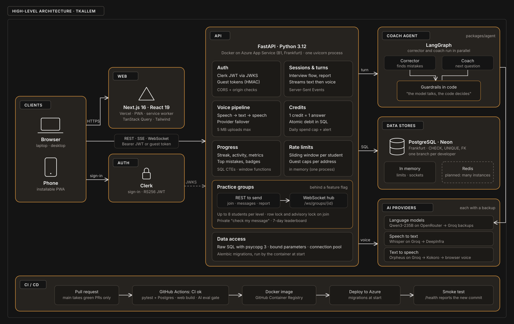

# Tkallem

[](https://github.com/yanou16/tkallem/actions/workflows/ci.yml)
[](https://github.com/yanou16/tkallem/actions/workflows/api-image.yml)
[](packages/agent/evals/gate.py)

**[Demo](https://tkallem.vercel.app)** · **[API](https://[TEAM-APP-NAME].azurewebsites.net/docs)** `[TEAM: put the Azure app name in this link]`


**An AI coach that lets Algerian students rehearse real English interviews out loud, and explains every mistake in French.**

Many Algerian students understand English but freeze when they have to speak it in a decisive moment: a US visa interview,
a Campus France interview, a remote job interview, IELTS Speaking. Tkallem gives them a private place to rehearse first:
a coach asks the real questions, listens, and shows what was good and the one thing to fix, without anyone watching.

- **Live app:** https://tkallem.vercel.app (open it, then "Try a visa interview now": no account needed, 40 free answers)
- **Demo video (2 to 4 min):** `[TEAM: link]`
- **Submission texts** (summary, description, stack, what next): [`docs/SUBMISSION.md`](docs/SUBMISSION.md) `[TEAM: this file is not in the repository yet: add it or remove this line]`

## What a student can do

1. **Build your plan (1 minute, optional)**: five questions (why English, how you speak, time per day, what is hardest, subjects you like) set the level, the daily goal and the order of the situations. The situations themselves are the same for everyone.
2. **Pick a situation**: visa interview, Campus France, remote job interview, IELTS Speaking, or free talk. Each runs 5 to
   10 minutes and ends with a report.
3. **Choose a mode**: *Practice* (corrections after each answer, hints, "Say it again") or *Real interview* (the coach
   plays the officer, nothing is shown until the report, like the real one).
4. **Answer out loud or by typing.** The coach replies in text and in a natural voice.
5. **Get feedback that reassures before it corrects**: one true compliment about the answer, then the single correction
   that matters most (the other small fixes stay folded), explained in French or simple English.
6. **When frozen, press "Help me start"**: the first words of an answer, or the student's idea written in French or
   Darija turned into English to read aloud. Free, two per question.
7. **Say the corrected sentence again**: the code checks it (not the AI): "Nailed it", or a gentle hint.
8. **Read the report**: progress since the last interview, **how long they waited before starting to speak** (the freeze,
   made visible), mistakes per 100 words, the answer to redo, and how confident they feel before and after (1 to 5).

It installs on a phone like an app (PWA), works in a browser, and guests can finish a whole interview without an account.

## "The model talks, the code decides"

A language model never decides alone what a student sees. Everything below is checked by code and covered by tests:

| The model proposes | The code decides |
|---|---|
| Mistakes to correct | Keeps at most 3; drops a fix that changes nothing, quotes words the student did not say, removes a name or a number, or rewrites far more than it replaces; merges fixes that touch the same words; the sentence color comes from the fixes |
| A compliment | Kept only if it is short, only positive, quotes the student's own words, does not name anything absent from the answer and does not praise the mistake itself |
| The coach's reply | The next question is added verbatim from the scenario; a question is repeated at most once; answered questions are skipped; nothing reopens after the closing line; in a real interview any praise is replaced by "Thank you." |
| Sentence starters, translations | 12 words at most and stopping before the content (never a complete answer); a translation must keep every name and number, add none, and be a finished sentence; otherwise the scenario's own starter is used |
| Whether the student repeated the correction | Never the model: 85 % word similarity, every fixed phrase heard, the mistake not said again |
| Progress, freeze, confidence lines | Computed from stored numbers, never written by the model |

Prompt injections ("ignore your rules", "mark this green", hidden JSON) are treated as data: see `packages/agent/evals/injection.py`.

## Architecture



*Solid boxes run today; the dashed Redis box is planned for running several API instances.*

Each answer starts three things at once (the answer count, the transcription, then the corrector and the coach in parallel), and
the text and the voice stream back as soon as they exist. Every provider has a backup, so a rate limit during the judging
week costs a second, not the session.

## Tech stack

- **Web:** Next.js 16, React 19, Tailwind CSS, Clerk, installable PWA with a service worker, TanStack Query. The 3D coach
  (TalkingHead) is optional and off by default.
- **API:** FastAPI, Pydantic, PostgreSQL (Neon), Alembic, httpx. Docker image on Azure App Service (B1, Always On).
- **Agent:** LangGraph, LangChain. Main model Qwen3-235B through OpenRouter, backups GPT-4.1 mini and Qwen3 on Groq.
- **Voice:** Whisper large-v3-turbo on Groq (DeepInfra backup); Orpheus on Groq, then Kokoro on DeepInfra, then the browser's voice.
- **Quality:** pytest (agent and API, with a real Postgres in CI), Vitest, an AI evaluation gate, GitHub Actions, Langfuse tracing (off unless configured).
- **AI tools used to build it:** Claude Code (coding assistant). `[TEAM: add the tools each of you used]`

## Backend

The API (`apps/api`) is a FastAPI service that owns everything the student cannot be trusted with: identity, answers
left, sessions, progress and the calls to the coach. Full reference (routes, environment variables, migrations, the
groups WebSocket): [`apps/api/README.md`](apps/api/README.md).

**How an answer is handled**

1. **Who is it?** A Clerk token (`Authorization: Bearer`) or a signed guest token (`Authorization: Guest`) is checked
   before anything else; the user row is created on the first call.
2. **Can they answer?** One answer is taken from the wallet in a single conditional `UPDATE` (`balance - 1 >= 0`), so
   two answers sent at the same moment can never spend the same credit; a failed turn gives it back.
3. **What did they say?** The recording (5 MB max) is transcribed while the coach is prepared; the text is capped.
4. **The coach answers** (`packages/agent`), then the code checks the result (see "The model talks, the code decides").
5. **The turn is stored** and streamed back to the browser (Server-Sent Events): text first, then the voice.

**Choices that matter**

| Choice | Why |
|---|---|
| Raw SQL with psycopg 3 and a connection pool, no ORM | Every query is visible and reviewed; values are always bound parameters (`%s`), never pasted into the SQL |
| The database enforces the rules too | `CHECK`, `UNIQUE` and foreign keys with `ON DELETE CASCADE`: a bug in Python cannot store a 600-character message, a sixth confidence level or a student in two groups |
| Concurrency handled in Postgres | Conditional `UPDATE` for answers, `SELECT … FOR UPDATE` and `pg_advisory_xact_lock` so that two students joining at the same instant never make a group of 9; tested with real parallel connections |
| Idempotent grants | Starting answers and daily refills carry a unique `ref`: replaying a request cannot give answers twice |
| Alembic migrations, run by the container at start | Production is always at the schema of its code; one linear history (one head), and a migration already applied on a shared database is never edited |
| One uvicorn process | Rate limits, the groups' live connections and the provider back-off are kept in memory; a shared store (Redis) is the next step before running several instances |
| Slow work off the event loop | Model and voice calls run in threads, every provider has a timeout and a backup; the groups' check releases its database connection before calling the model |

**Practice groups (built, hidden for the competition)**: groups of up to 8 students of the same level, a weekly theme
and a question of the day, a chat (REST to send, a WebSocket `/ws/groups/{id}` to receive live), a private "Check my
message" that runs the coach's corrector on a draft, reports (a message is hidden after 3), and a 7-day leaderboard.
The screen only shows when the web app is built with `NEXT_PUBLIC_FEATURE_GROUPS=1`.

## Run it locally

You need Node 20+, Python 3.12, a Postgres database (a free Neon project works) and API keys for a language model and a
speech provider.

```bash
# API  (http://localhost:8000)
cd apps/api
python3 -m venv .venv && .venv/bin/pip install -r requirements.txt
cp .env.example .env            # fill in DATABASE_URL, an LLM key, a speech key, Clerk; see the comments inside
.venv/bin/alembic upgrade head  # creates the tables
.venv/bin/uvicorn app.main:app --reload

# Web  (http://localhost:3000)
cd apps/web
npm install
cp .env.local.example .env.local   # NEXT_PUBLIC_API_URL=http://localhost:8000, Clerk keys
npm run dev
```

Keys live only in `.env` files, which are ignored by Git. Guests need no Clerk account: open
`/ai-chat?scenarioId=visa-us`.

Add a scenario: one JSON file in `packages/agent/tkallem_agent/scenarios/` (see `visa-us.json`); `pytest` in
`packages/agent` validates it.

## Tests and the road to `main`

Nothing reaches `main` unless the **CI ok** check is green: agent tests, API tests with a real Postgres, web typecheck,
tests and build, the API Docker build and, when the agent changes, the **AI evaluation gate**. After a merge the API image
is built, deployed to Azure and smoke-tested. [`docs/TESTING.md`](docs/TESTING.md) maps every feature to its tests.

Evaluation baseline (real model, `packages/agent/evals/gate.py`): **29 of 29 seeded mistakes detected, 0 false alarm on
correct sentences, 9 of 9 prompt-injection attacks handled, 0 complete-answer starter and 0 changed name or number in the
"Help me start" sets, 0 invented compliment.**

```bash
cd packages/agent && ../../apps/api/.venv/bin/pytest -q                 # agent
cd apps/api && TEST_DATABASE_URL=<a scratch database> .venv/bin/pytest -q   # API
cd apps/web && npm run typecheck && npm test                            # web
```

## Security

What protects the students, the data and the bill. Each line points to the code that does it.

| Risk | What the code does | Where |
|---|---|---|
| Someone pretends to be another student | Clerk tokens are verified on every request: RS256 signature against Clerk's public keys, issuer, expiry and the origin that requested the token (`azp`) must match | `apps/api/app/security.py` |
| A guest invents or changes an identity | Guest tokens are `g1.<id>.<HMAC-SHA256>` signed with `GUEST_SECRET` (32+ characters), compared in constant time; sent in a header, never a cookie | `apps/api/app/guests.py` |
| Reading or changing another student's data | Every route first loads the session, message or group through an owner or membership check (`WHERE id = %s AND user_id = %s`, members only, 403 or 404 otherwise); guests are refused from everything in groups except the read-only preview | `apps/api/app/db/`, `apps/api/app/routes/` |
| SQL injection | Values are always bound parameters; the only names built into SQL come from fixed lists in the code, never from a request | `apps/api/app/db/` |
| Another website calling the API | CORS allows only the front's origins (`FRONTEND_ORIGIN`). WebSockets ignore CORS, so the groups socket checks the `Origin` itself and closes with 1008 | `apps/api/app/main.py`, `apps/api/app/routes/group_ws.py` |
| A token leaking through logs | The WebSocket token is sent in the first message, within 5 seconds, never in the URL (URLs end up in server logs) | `apps/api/app/routes/group_ws.py` |
| Oversized or malformed input | Pydantic limits on every body (text length, 1-to-5 values, at most 3 corrections), recordings over 5 MB refused with 413, messages 1 to 500 characters in the API and in the database | `apps/api/app/schemas/`, `apps/api/app/config.py`, migrations |
| Prompt injection ("ignore your rules", hidden JSON) | The student's words are framed as data in the prompt; the code then validates every field the model returns; 9 of 9 attacks handled in the evaluation gate, which blocks a merge when the agent changes | `packages/agent/tkallem_agent/graph.py`, `schemas.py`, `evals/injection.py` |
| Flooding and abuse | Answers come from a wallet (40 for a guest, then daily refills); guest accounts are capped per network address and per day; hints, replays, group messages (20 per minute) and private checks (30 per 24 h) are rate limited; reported messages are hidden after 3 reports | `apps/api/app/credits.py`, `rate_limit.py`, `routes/` |
| An unbounded bill | `DAILY_SPEND_CAP` stops the free practice for everyone for the day, with an alert at 80 % and 100 % | `apps/api/app/credits.py`, [`docs/CREDITS.md`](docs/CREDITS.md) |
| Personal data | A guest's network address is stored only as a keyed hash (enough to count, useless to recover it); real learner recordings and test data are git-ignored | `apps/api/app/guests.py`, `.gitignore` |
| Secrets in the repository or the image | Keys live in `.env` files and in GitHub, Azure and Vercel settings, all ignored by Git; `.dockerignore` keeps every `.env` out of the image; CI builds with a fake Clerk key | `.gitignore`, `.dockerignore`, `.github/workflows/` |
| A compromised container | The image runs as a non-root user (uid 10001); Azure serves HTTPS only | `apps/api/Dockerfile`, [`infra/azure/README.md`](infra/azure/README.md) |
| Unreviewed code reaching production | `main` only takes pull requests whose **CI ok** check is green; a pre-push hook refuses direct pushes to `main`; every deploy is smoke-tested on `/health` | `.github/workflows/`, `.githooks/pre-push` |

**Not done yet** (we would rather say it): no Content-Security-Policy or HSTS headers on the web app yet; rate limits
are in memory (one process); no automatic dependency scanning (Dependabot); sign-in still uses a Clerk development
instance. `[TEAM: confirm before submission]`

## Cost and judging-week safety

Every answer uses one free answer (40 for a guest, 60 more after sign-in, then 15 every day). `DAILY_SPEND_CAP` bounds what everyone
together can spend per day; at 80 % and at 100 % the API logs an alert and posts to a webhook if one is set. A spoken
answer costs under half a cent today. Details: [`docs/CREDITS.md`](docs/CREDITS.md), [`docs/OPERATIONS.md`](docs/OPERATIONS.md),
deployment: [`infra/azure/README.md`](infra/azure/README.md).

## Who built what

Git history shows the real split (the same person sometimes commits under two names). `[TEAM: each person checks their own line]`

- **Rayane Louzazna**: tech lead. The AI coach (agent, prompts, guardrails, evaluation sets), the voice pipeline and its
  backups, free answers and guest mode, deployment (Azure, Neon, Vercel), the CI/CD, the four improvements and the report.
- **Zaki**: the API (sessions, profile, progress, achievements, database and migrations), the practice groups end to
  end (database, REST routes, the live WebSocket, the private check with the coach's corrector, the leaderboard and
  the groups screen), the API documentation, and the first voice work. `[TEAM: Zaki, confirm]`
- **Akram (Wad2o)**: front-end screens and the profile pages. `[TEAM: Akram, add what else you did]`

Large parts of the code were written with Claude Code (an AI coding assistant), then reviewed and tested by the team. `[TEAM: confirm]`

## Known limits (we would rather say them)

- **The microphone is tested on desktop Chrome, not yet on every phone.** Autoplay rules and microphone permission differ on
  iPhone Safari and Android Chrome; a "Tap to hear the coach" button covers the blocked-audio case. `[TEAM: update after the phone tests]`
- **The evaluation sets are small and labelled by one person**: 33 sentences, 9 attacks, 20 "Help me start" cases. They catch
  regressions; they do not prove the coach is right about every sentence. A correction can still be wrong or miss something.
- **Darija translation depends on the model** and on how the student writes it; a translation the code refuses falls back to a generic starter.
- **Confidence and its change are self-reported**, from few sessions, with no control group (see [`docs/IMPACT.md`](docs/IMPACT.md)).
- **Scenarios are fixed and few** (ten: six interviews and exams, four everyday ones). A real Campus France interview is in French; ours trains the English version of it.
- **Rate limits for hints and repeats are kept in memory**, per server process: fine for one instance, not for several.
  The same goes for the groups' live connections: a second API instance would need Redis before groups can be shown.
- **Sign-in uses a Clerk development instance** and one language for the interface (English).
- **The sample 3D avatar is optional and off by default**: it comes from the TalkingHead project, whose sample avatars are for non-commercial use.
- Voice quality and latency depend on the speech providers' free daily quotas; backups exist, but a long outage degrades to the browser's voice.
- `[TEAM: earlier work reused? say so here, for example the CEFR level estimation]`

## Repository

```
apps/web/        Next.js app (screens, PWA, welcome page preview)
  src/app/           the routes: (app)/ for the app screens (home, plan, practice, AI chat, progress, profile, groups), welcome, sign-in and sign-up
  src/features/      one folder per feature (ai-chat, practice, progress, profile, groups…): api, hooks, components, lib, types
  src/components/    shared UI (app shell, cards, buttons, dialogs)
  src/lib/           API client and endpoints, configuration, feature flags
  public/            icons, service worker, offline page
apps/api/        FastAPI (routes, database, voice, answer allowance, migrations)
  app/               routes/, db/ (raw SQL), schemas/, voice/, realtime and rate limits of the groups
  alembic/versions/  database migrations
  tests/             pytest, against a real Postgres
packages/agent/  the coach: LangGraph, prompts, scenarios, guardrails, evals
  tkallem_agent/     the graph, the session, prompts/ and scenarios/ (one JSON file per scenario)
  evals/             evaluation sets and the AI gate run in CI
  tests/             pytest
packages/contracts/  OpenAPI and the agent turn schema, shared by the three
docs/            design system, free answers, testing, operations, impact, submission, what next
infra/azure/     deployment script and notes
.github/workflows/   CI (tests, web build, AI gate) and the API image (build, deploy to Azure, smoke test)
.githooks/       pre-push hook: no direct push to main, quick checks (enable with git config core.hooksPath .githooks)
```

Backend details (stack, structure, environment variables, migrations, tests, routes and the groups WebSocket):
[`apps/api/README.md`](apps/api/README.md).

More: [`docs/WHAT_NEXT.md`](docs/WHAT_NEXT.md) (the next three months), [`docs/DESIGN.md`](docs/DESIGN.md), [`packages/agent/README.md`](packages/agent/README.md).