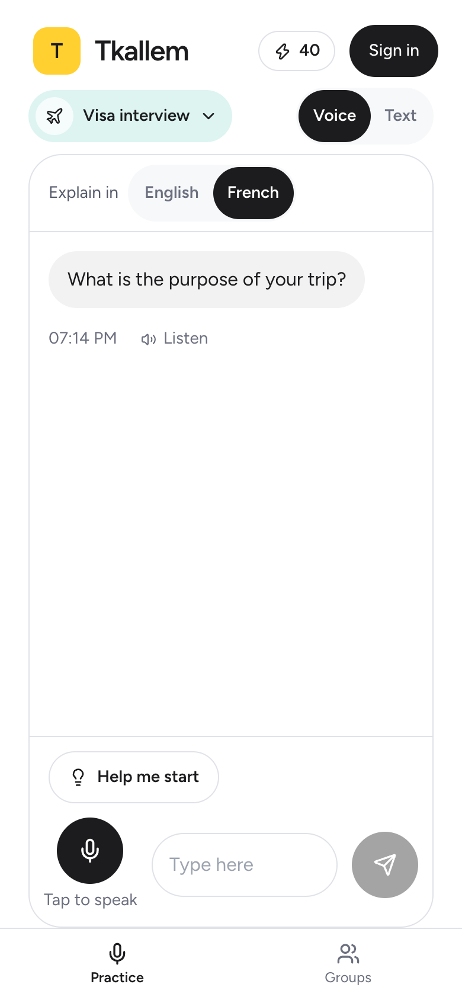
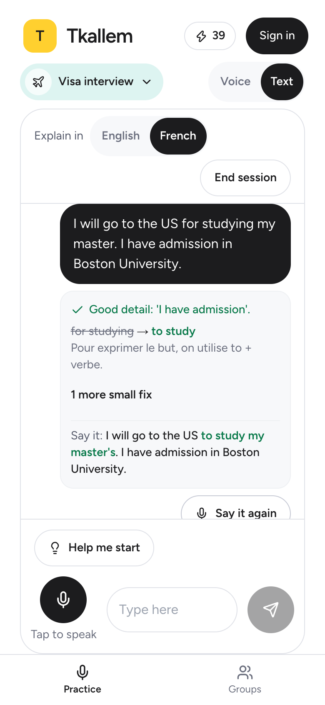
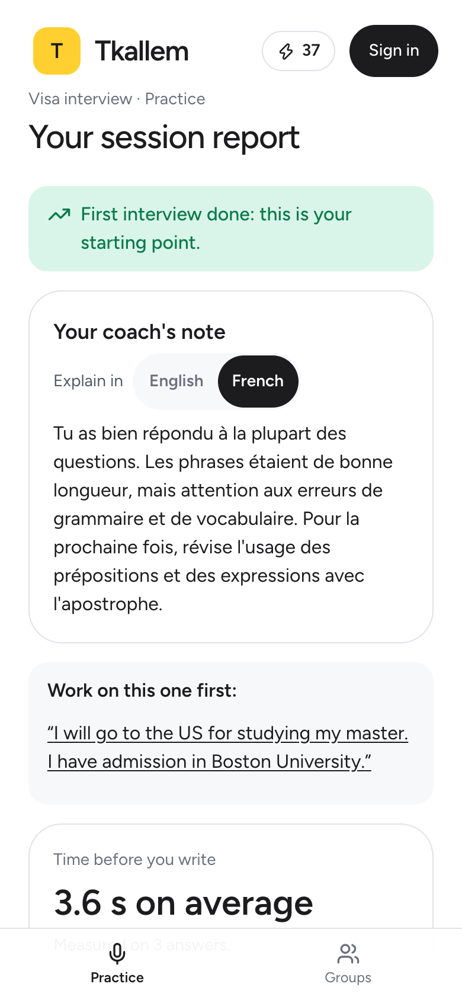
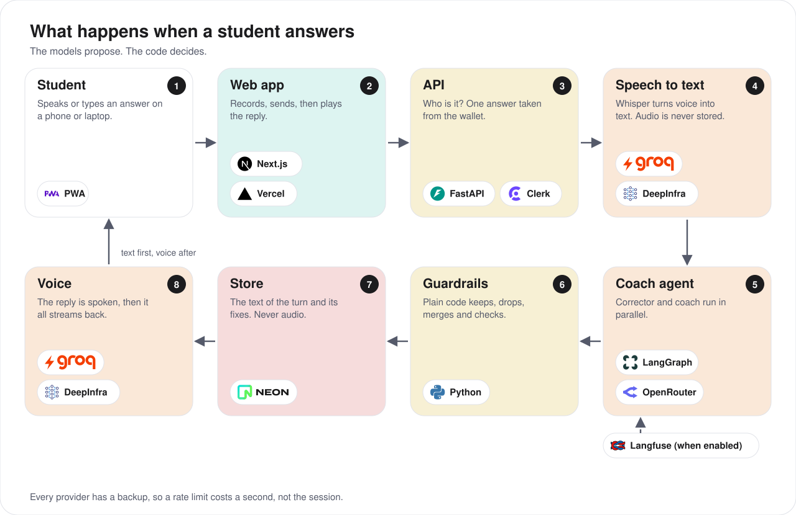
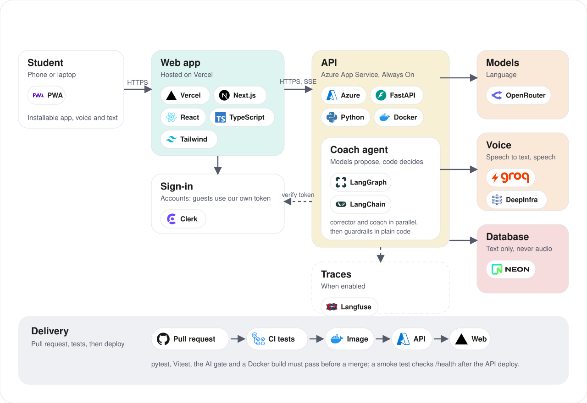
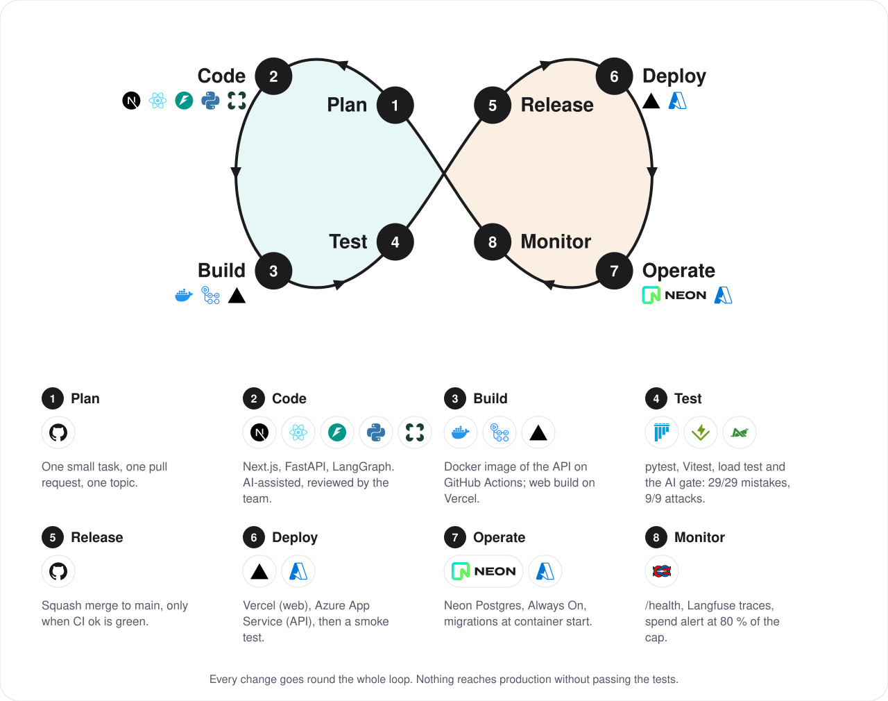

<div align="center">


# Tkallem

**Rehearse the real interview out loud, with an AI coach that explains every mistake in French.**

An English speaking coach for Algerian students who understand English but freeze when they have to speak it:
a US student visa interview, a university admission interview, a remote job interview, IELTS Speaking.

[**Try it now**](https://tkallem.vercel.app) · [Demo video](https://youtu.be/rMd0lO5nTWI) · [API docs](https://tkallem-api-rayane.azurewebsites.net/docs) · [Documentation](#documentation)

[](https://github.com/yanou16/tkallem/actions/workflows/ci.yml)
[](https://github.com/yanou16/tkallem/actions/workflows/api-image.yml)
[](packages/agent/evals/gate.py)
[](https://github.com/yanou16/tkallem/releases)

</div>

<table>
  <tr>
    <td align="center"></td>
    <td align="center"></td>
    <td align="center"></td>
  </tr>
  <tr>
    <td align="center"><sub><b>Real questions</b><br>a visa interview, first question</sub></td>
    <td align="center"><sub><b>One compliment, one fix</b><br>explained in French or English</sub></td>
    <td align="center"><sub><b>A report</b><br>what to work on first</sub></td>
  </tr>
</table>

## Contents

[Why Tkallem](#why-tkallem) · [Try it in 30 seconds](#try-it-in-30-seconds) · [What a student can do](#what-a-student-can-do) ·
[How the AI works](#how-the-ai-works) · [Architecture](#architecture) · [Tech stack](#tech-stack) · [DevOps](#devops) ·
[Run it locally](#run-it-locally) · [Quality and security](#quality-and-security) · [Cost and limits](#cost-and-limits) ·
[Impact and what next](#impact-and-what-next) · [Team](#team) · [Documentation](#documentation)

## Why Tkallem

Many Algerian students can read and understand English but freeze when they have to speak it at a decisive moment. There
is nowhere safe to rehearse: a teacher is not available at night, and a friend's feedback is polite, not precise.

Tkallem is that place. A coach asks the real questions, listens, and shows what was good and the one thing to fix first,
with nobody watching. The student can also *see* the freeze itself: how long they waited before starting to answer.

<!-- TODO (the team): who has this problem and who you spoke to: how many students, where, what they said. Real numbers only. -->

## Try it in 30 seconds

1. Open **https://tkallem.vercel.app** and press **Try a visa interview now**. No account.
2. Answer the first question out loud, or type it. Not sure how to start? Press **Help me start**.
3. Read the correction, press **Say it again**, finish the interview and open the **report**.

A guest has **1,000 free answers** (about 160 full sessions). Signing in adds 200 more and 50 every day. It installs on a phone like an app (PWA).
A guest's sessions, reports and progress are kept on that device; creating an account moves them to the account.

## What a student can do

| | |
|---|---|
| **Pick a real situation** | Visa interview, university admission interview, remote job interview, IELTS Speaking, everyday scenes (renting a room, the airport, a taxi…). 5 to 10 minutes each. |
| **Choose a mode** | *Practice* (corrections after each answer, hints) or *Real interview* (the coach plays the officer, nothing is shown until the report). |
| **Voice message or text** | Record one answer and hear the coach reply in a natural voice, or type it and read the reply. The microphone only asks for permission when the student taps it. |
| **Be reassured, then corrected** | One true compliment, then the single correction that matters most, explained in French or simple English. |
| **Get unstuck** | **Help me start** gives the first words of an answer, or turns an idea written in French or Darija into English to read aloud. |
| **Repeat the fix** | **Say it again**: the code, not the AI, checks the repeated sentence. |
| **See the freeze** | The report shows how long the student waited before speaking, mistakes per 100 words, the answer to redo and how confident they feel at the end. |
| **Build a plan** | Five short questions (why you need English, your level, daily practice time, what is hardest, the subjects you like) set the level, the daily goal and the order of the situations. They are optional: a visa interview can start straight away. |
| **Practice with others** | Groups of up to 8 students of the same level, with the question of the day, a private **Check my English** for a draft before sending, and a weekly leaderboard. A visitor without an account sees a read-only preview. |
| **Keep what was learned** | **Progress** and past reports, **Phrases** (the corrections of earlier sessions in one place, with *Say it again*) and a phrase of the day to say out loud. |

## How the AI works



The idea: **the model talks, the code decides.** A language model proposes the mistakes, the compliment and the reply;
plain code then keeps, trims, merges or rejects them. The next question, the sentence color and the progress numbers are
computed, never generated. Prompt injections ("ignore your rules", "mark this green") are treated as data and checked
against 9 attacks in CI.

Every provider has a backup, so a rate limit during the judging week costs a second, not the session. The coach's voice has five levels: **Azure Speech** (a neural voice, free plan), **Piper (a voice that runs on our own server, no quota)**, Groq, DeepInfra, then the browser's own voice.

**→ [Read the full AI coach document](docs/ai.md)** (the guardrails table, providers and backups, evaluation, privacy, limits)

## Architecture



A Next.js app on Vercel talks to one FastAPI service on Azure. The API owns everything the student cannot be trusted with:
identity, free answers, sessions and the calls to the coach. Only the text of the answers is stored, never audio.

**→ [Read the full system design](docs/system-design.md)** (one answer step by step, data model, design choices, security, capacity, failure modes)

## Tech stack


**AI tools used to build it:** Claude Code (an AI coding assistant) wrote a large part of the code, which the team reviewed
and tested. <!-- TODO (the team): add the AI tools each member used. -->

## DevOps



Nothing reaches `main` unless **CI ok** is green: agent tests, API tests against a real Postgres, web typecheck, tests and
build, the API Docker build and, when the agent changes, the **AI gate** (29 of 29 seeded mistakes detected, no false
alarm, 9 of 9 attacks handled). After a merge the API image is built, deployed to Azure and smoke-tested: the deploy fails
unless the new commit is really live.

**→ [Read the DevOps document](docs/devops.md)** (the checks, deploy, secrets, monitoring, releases, rollback, the judging-week routine)

## Run it locally

You need Node 20+, Python 3.12, a Postgres database (a free Neon project works) and API keys for a language model and a
speech provider.

```bash
# API  (http://localhost:8000)
cd apps/api
python3 -m venv .venv && .venv/bin/pip install -r requirements.txt
cp .env.example .env            # fill in DATABASE_URL, an LLM key, a speech key, Clerk; see the comments inside
.venv/bin/alembic upgrade head  # creates the tables
.venv/bin/uvicorn app.main:app --reload

# Web  (http://localhost:3000)
cd apps/web
npm install
cp .env.local.example .env.local   # NEXT_PUBLIC_API_URL=http://localhost:8000, Clerk keys
npm run dev
```

The optional server-side voice (Piper, about 63 MB, MIT) is downloaded and checked against its SHA-256 with
`python apps/api/scripts/fetch_piper_voice.py <folder>`; then set `PIPER_MODEL_PATH` to the `.onnx` file. Without it the voice chain simply
skips Piper. The Docker image does this for you.

Keys live only in `.env` files, which Git ignores. Guests need no Clerk account: open `/ai-chat?scenarioId=visa-us`.
Add a scenario with one JSON file in `packages/agent/tkallem_agent/scenarios/` (see `visa-us.json`).

```bash
cd packages/agent && ../../apps/api/.venv/bin/pytest -q                      # agent
cd apps/api && TEST_DATABASE_URL=<a scratch database> .venv/bin/pytest -q   # API (about 520 tests)
cd apps/web && npm run typecheck && npm test                                 # web (about 280 tests)
```

## Quality and security

- **Tested at every level:** agent and API unit tests, API tests against a real Postgres (including two answers sent at the
  same instant), web tests, a load test (Locust), and an **AI evaluation gate** that blocks a merge when the coach gets worse.
- **Evaluation baseline (real model):** 29 of 29 seeded mistakes detected, 0 false alarm on correct sentences, 9 of 9
  prompt-injection attacks handled, 0 complete-answer starter and 0 changed name or number in "Help me start".
- **Security by design:** every token is verified on every request; every query is parameterized and checked for ownership;
  CORS and WebSocket origins are enforced; the free-answer wallet and a daily spending cap bound abuse and the bill; secrets
  never enter the repository or the image; the container runs as a non-root user.

**→ The full security table is in the [system design](docs/system-design.md#security).**

**→ Load test results (pool of 5, 10 and 15 connections, 30 and 50 simulated users) are in the [system design](docs/system-design.md#performance).**

**Not done yet** (we would rather say it): no Content-Security-Policy header (the web app does send `nosniff`, frame denial, a
referrer policy and a permissions policy); rate limits are in memory (one API process); dependency scanning is limited to
`npm audit` for critical advisories in CI, with nothing yet for the Python packages; sign-in uses a Clerk development instance.

## Cost and limits

One answer from the student uses one free answer. On the demo server a guest gets **1,000**; signing in adds **200** and moves the guest's unused
answers over; then **50 every day**, never above **200**. One network may create 1,000 guests a day (5,000 in total). These are settings
(`GUEST_CREDITS`, `LOGIN_BONUS`, `DAILY_REFILL`, `REFILL_CAP`, `GUEST_IP_DAILY_CAP`, `GUEST_DAILY_CAP`); the defaults in the code are the smaller
100, 60, 15 and 45, so a local run stays frugal. `DAILY_SPEND_CAP` (default 5000) bounds what everyone together can
spend in a day, with an alert at 80 % and at 100 %.

| One answer costs us | |
|---|---|
| Typed | about 0.0003 $ |
| Spoken, voice by Groq Orpheus | about 0.0034 $ |
| Spoken, voice by DeepInfra Kokoro | about 0.0009 $ |
| Spoken, voice by Piper (our own server) | no provider fee, only server time |

The cap therefore bounds a day at about 1.5 $ (typed) to 17 $ (all spoken with Orpheus). The database pool is 10
connections; a Locust load test of the judge journey (50 simulated users, fake model) kept the median answer at 2.3 s with
no errors ([`apps/api/loadtest/`](apps/api/loadtest/README.md)).

**Known limits** (we would rather say them):

- **The microphone and the voice are tested on desktop Chrome and with an automated browser, not yet on every phone.** A "Tap to hear
  the coach" button covers blocked audio.
- **A live call mode (WebRTC with Pipecat, through a Cloudflare relay) is built and tested but switched off** (`VOICE_CALL_ENABLED=false`):
  on the single vCPU of our demo server the real-time audio was not smooth enough on phones. The voice message gives the same corrections
  without that risk, and the code stays for the day the server grows.
- **The evaluation sets are small and labelled by one person** (33 sentences, 9 attacks, 20 "Help me start" cases). A
  correction can still be wrong; one example is described in [docs/ai.md](docs/ai.md#limits).
- **Scenarios are few** (ten). A real admission or visa interview may be held in another language; ours trains the English version of it.
- **One API process:** several instances would need Redis first.
- **Sign-in uses a Clerk development instance** and the interface is in English only.
- **The optional 3D avatar** comes from the TalkingHead project, whose sample avatars are for non-commercial use; it is off by default.
- Voice quality and latency depend on the providers' free quotas (Groq's free plan allows about 100 voices a day): the chain is Groq,
  DeepInfra, Piper on our server, then the browser's voice. Piper is clear and fast, but less natural than Groq's.

## Impact and what next

What Tkallem can measure about students who freeze, from real sessions. Only averages, never a student: the **time before
the student starts** (the freeze meter), **confidence at the end of a session** (1 to 5, self-reported; a "before" question was removed because it confused first visits), and **mistakes per 100
words**. Honest limits: confidence is self-reported, the number of sessions is small, and there is no control group.
`apps/api/scripts/impact.py` prints the averages.

**Next three months.** We will put Tkallem in front of 30 students preparing visa and admission interviews, through
student clubs and language centers, and check whether their mistakes per 100 words and their time before speaking drop
over five sessions. We will add the scenarios they ask for, such as scholarship interviews, and a French interface. It
stays free to try with daily answers; intensive preparation packs and language-center partnerships would pay for it.
<!-- TODO (the team): name the clubs and language centers we will approach. -->

## Team

Git history shows the real split (the same person sometimes commits under two names).
<!-- TODO (the team): each person checks their own line and adds their full name if wanted. -->

| | |
|---|---|
| **Rayane Louzazna** | Tech lead. The AI coach (agent, prompts, guardrails, evaluation sets), the voice pipeline and its backups, free answers and guest mode, deployment (Azure, Neon, Vercel), the CI/CD, the four improvements ("Help me start", "Say it again", Practice and Real interview modes, corrections that reassure first), the freeze meter and the report, and the integration of the team's front-end work (call screen, group room and chat visual language by Akram, groups by Zaki). |
| **Zakaria Sabi (Zaki)** | The API (sessions, profile, progress, database and migrations), the practice groups (database, REST routes, live WebSocket, leaderboard; the screen is back in the app, read-only for visitors without an account), the API documentation, the load test, the first diagrams. <!-- TODO: Zaki, confirm --> |
| **Akram (Wad2o)** | The first front-end redesign (sign-in with Clerk), the dashboard and practice API routes, the real-time voice route (Pipecat, WebRTC) in the API, and the designs adopted in the app: the call screen, the practice group room and the chat's visual language (mint bubbles, pastel correction cards). <!-- TODO: Akram, confirm and add the full name --> |

## Documentation

Each document explains one part, with its diagram.

| Document | What it explains |
|---|---|
| [**System design**](docs/system-design.md) | The architecture, one answer step by step, the data model, design choices, security, capacity and failure modes |
| [**AI coach**](docs/ai.md) | How the coach works, the guardrails, providers and backups, evaluation, privacy, limits |
| [**DevOps and delivery**](docs/devops.md) | The CI checks, the AI gate, build and deploy, secrets, monitoring, releases and tags, rollback |
| [Agent integration](docs/agent-integration.md) | How the agent plugs into the API: endpoints, streaming events, errors |
| [API reference](apps/api/README.md) | Routes, environment variables, migrations |
| [Agent package](packages/agent/README.md) | `CoachSession`, scenarios, configuration, tests and evaluations |
| [Azure deployment](infra/azure/README.md) | Setting up the API on Azure and the front on Vercel |
| [Load test](apps/api/loadtest/README.md) | How to run the Locust test of the judge journey; its results are in the [system design](docs/system-design.md#performance) |

```
apps/web/            Next.js app: src/app (routes), src/features (one folder per feature), src/components, src/lib
apps/api/            FastAPI: app/ (routes, db with raw SQL, schemas, voice), alembic/ (migrations), tests/, loadtest/
packages/agent/      The coach: LangGraph graph, prompts, scenarios (one JSON file each), guardrails, evals
packages/contracts/  OpenAPI and the agent turn schema, shared by the three
docs/                The documents above and their diagrams (docs/images)
infra/azure/         Deployment script and notes
.github/workflows/   CI (tests, web build, AI gate) and the API image (build, deploy, smoke test)
.githooks/           Pre-push hook: no direct push to main (enable with: git config core.hooksPath .githooks)
```

## License

<!-- TODO (the team): choose a license and add a LICENSE file, for example MIT. Until then all rights are reserved by default. -->
All rights reserved by the authors until the team chooses a license.
