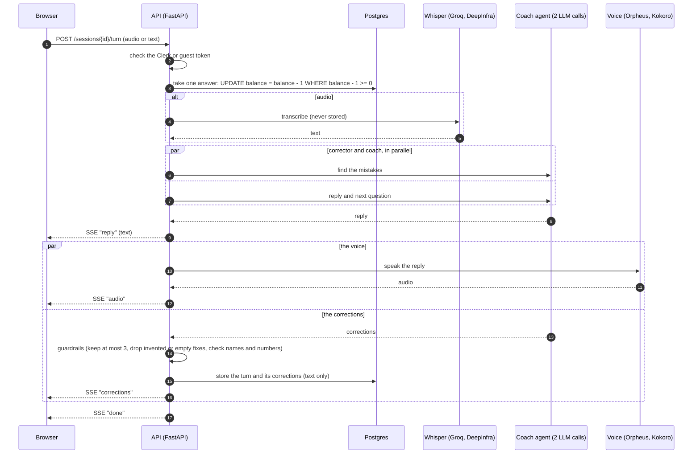
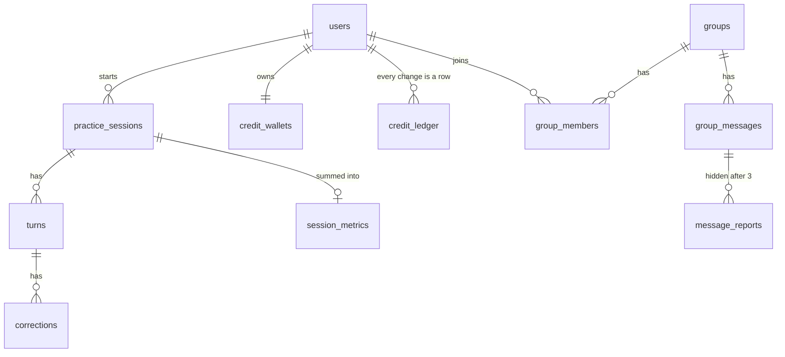

# Architecture

How Tkallem is built, why, and where its limits are. The picture is [`architecture.svg`](architecture.svg); the DevOps loop
is [`devops-loop.svg`](devops-loop.svg). Everything here is what runs today.

## The pieces

| Piece | What it is | Where it runs | What it owns |
|---|---|---|---|
| **Web app** (`apps/web`) | Next.js 16, React 19, installable PWA | Vercel | Screens, the microphone, playing the coach's voice. It trusts nothing: every decision is checked again by the API. |
| **API** (`apps/api`) | FastAPI, one process, raw SQL | Azure App Service (B1, Always On, Frankfurt) | Identity, free answers, sessions, progress, groups, the calls to the providers. |
| **Coach agent** (`packages/agent`) | LangGraph, prompts, scenarios, guardrails | Inside the API process | Playing the scenario, finding mistakes, the end-of-session note. |
| **Database** | PostgreSQL | Neon (Frankfurt, next to the API) | Everything that must survive: text of the turns, corrections, wallets, groups. Never audio. |
| **Sign-in** | Clerk | Clerk | Accounts. Guests use a signed token from the API instead. |
| **Models and voice** | OpenRouter, Groq, DeepInfra | Their servers | Language models, speech to text, text to speech. Each has a backup. |

One rule shapes the whole design: **the model talks, the code decides.** A model proposes; plain code checks, trims, rejects
or computes. The next question, the sentence color, the progress numbers and which corrections are kept never come from the
model alone.

## One answer, step by step

If something fails, the student does not pay for it: a failed turn gives the answer back, and a failed provider is replaced
by its backup (language model: after 12 seconds the backups are tried; speech to text and voice: second provider, then the
browser's own voice).

## Data model

The database enforces the rules too (`CHECK`, `UNIQUE`, foreign keys with `ON DELETE CASCADE`): a bug in Python cannot store a
600-character message, a sixth confidence level, or a student in two groups. Guests are ordinary `users` rows whose
`clerk_user_id` starts with `guest:`, so the same code serves both.

## Design choices

| Choice | Why |
|---|---|
| Raw SQL with psycopg 3 and a connection pool, no ORM | Every query is visible and reviewed; values are always bound parameters, never pasted into the SQL. |
| Concurrency handled in Postgres | A conditional `UPDATE` takes one answer so two answers sent at once never spend the same one; `SELECT … FOR UPDATE` and an advisory lock stop two students from filling the last place of a group at the same instant. |
| Idempotent grants | Starting answers and daily refills carry a unique `ref`: replaying a request cannot give answers twice. |
| Alembic migrations run when the container starts | Production is always at the schema of its code. One linear history; a migration already applied is never edited. |
| Text and voice stream as soon as they exist | The reply is sent before the corrections are ready, and the voice starts before the answer is fully processed. |
| Slow work off the event loop | Model and voice calls run in threads with timeouts and backups. |
| One uvicorn process | Rate limits, the groups' live connections and the providers' back-off are kept in memory. The honest next step is Redis before running several instances. |

## Capacity and limits

- **Database pool:** 10 connections by default (`DB_POOL_MIN`, `DB_POOL_MAX`, `DB_POOL_TIMEOUT`). A Locust load test of the whole
  judge journey (guest, scenarios, session, five streamed answers, report) with a fake model found the pool was the first
  thing to saturate: with 50 simulated users the median answer went from 3.8 s (pool of 5, 89 % of requests waiting) to 2.3 s
  (pool of 10, 5 % waiting), with no errors. Neon's smallest plan allows 97 connections. The test used a fake model, so real
  answers, which hold a connection longer, are slower. See `apps/api/loadtest/`.
- **Bill:** `DAILY_SPEND_CAP` (default 5000 answers a day, everyone together) is the switch. An answer costs about 0.0003 $
  typed and 0.0009 to 0.0034 $ spoken, so the cap bounds the day at roughly 1.5 to 17 $. Alerts at 80 % and 100 %.
- **Abuse:** a wallet per user, guest accounts capped per network address and per day, rate limits on hints, replays and
  group messages.
- **Single instance:** fine for the competition; before scaling out, move the in-memory limits and the groups' sockets to Redis.

## Failure modes we planned for

| What breaks | What the student sees |
|---|---|
| The main language model is slow or down | A backup model answers; a duplicate request is sent after 3 seconds if the first is slow |
| A speech provider is rate limited | The second provider; at worst the browser's own voice |
| The model returns something unusable twice | "Please say that again": nothing was recorded and no answer was spent |
| The free budget of the day is used up | "Today's free practice is used up, come back tomorrow" |
| Clerk is slow to load | Guest mode waits for Clerk today; this is a known weak point (see the README) |

## Where to read next

- The agent and how it plugs into the API: [`agent-integration.md`](agent-integration.md), [`../packages/agent/README.md`](../packages/agent/README.md)
- Every route, variable and migration: [`../apps/api/README.md`](../apps/api/README.md)
- Deployment on Azure and Vercel: [`../infra/azure/README.md`](../infra/azure/README.md)
