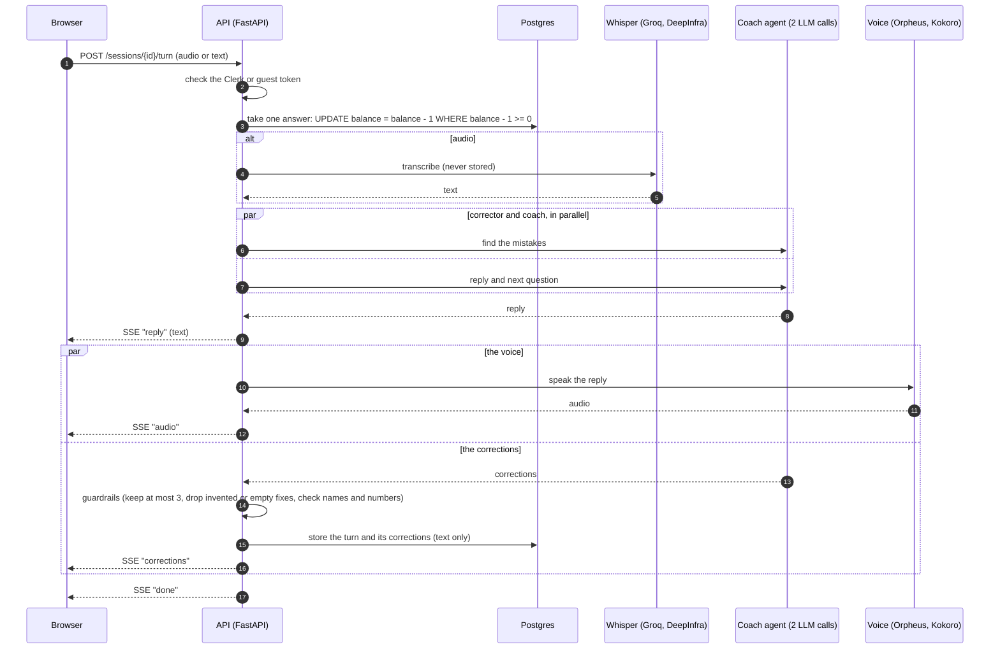
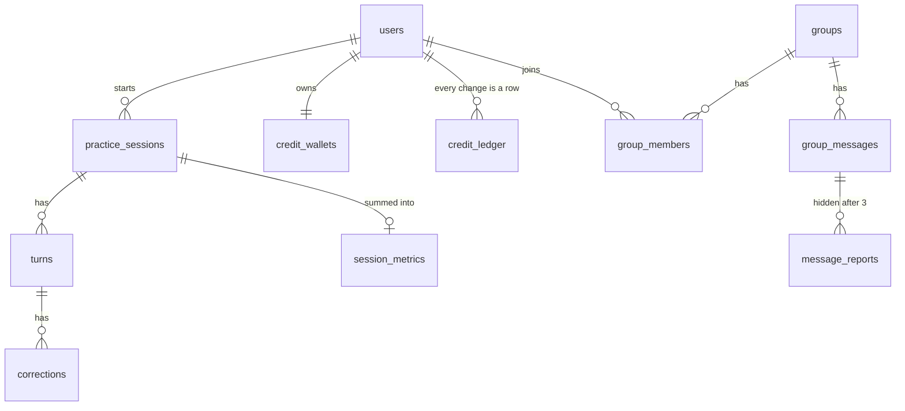

# System design

How Tkallem is built, why it is built that way, and where its limits are. This page describes what runs today.
Other parts: [AI coach](ai.md) · [DevOps and delivery](devops.md) · [← back to the README](../README.md)

## Contents

1. [Goals and constraints](#goals-and-constraints)
2. [The big picture](#the-big-picture)
3. [The pieces](#the-pieces)
4. [One answer, step by step](#one-answer-step-by-step)
5. [Data model](#data-model)
6. [Design choices](#design-choices)
7. [Security](#security)
8. [Capacity and limits](#capacity-and-limits)
9. [Failure modes we planned for](#failure-modes-we-planned-for)
10. [Performance](#performance)

## Goals and constraints

**What the system must do.** A student who understands English but freezes when speaking opens a link, answers a
real interview question out loud, and within seconds hears the coach and sees one compliment and one fix. Without
creating an account.

| Goal | What it means for the design |
|---|---|
| A judge or a student can finish an interview alone, on a phone, on the first try | Guest mode with a signed token, a PWA, no sign-up wall, a first question in about a second |
| The coach is never wrong in a way that hurts | The model proposes, plain code checks every field (see [AI coach](ai.md)) |
| The bill cannot run away | One wallet of free answers per person, a global daily spending cap, an alert before it is reached |
| A provider outage costs seconds, not the session | A backup for every provider (language model, speech to text, voice) |
| Nothing sensitive is kept | Only the text of the answers is stored, never audio |

**Constraints.** A student team, a free or student-credit budget (Vercel Hobby, Neon free plan, Azure B1 from student
credit), and a hard date. That is why there is one API process, raw SQL and no Redis yet. Each is listed in
[Design choices](#design-choices) with the day it stops being enough.

## The big picture

A more detailed view, including the planned Redis box for running several API instances, is
[`images/architecture-detailed.svg`](images/architecture-detailed.svg).

## The pieces

| Piece | What it is | Where it runs | What it owns |
|---|---|---|---|
| **Web app** (`apps/web`) | Next.js 16, React 19, TypeScript, Tailwind, installable PWA | Vercel | Screens, the microphone, playing the coach's voice. It trusts nothing: the API checks everything again. |
| **API** (`apps/api`) | FastAPI, one process, raw SQL | Azure App Service (B1, Always On, Frankfurt) | Identity, free answers, sessions, progress, groups, the calls to providers. |
| **Coach agent** (`packages/agent`) | LangGraph, prompts, scenarios, guardrails | Inside the API process | Playing the scenario, finding mistakes, writing the end-of-session note. |
| **Database** | PostgreSQL | Neon (Frankfurt, next to the API) | What must survive: text of the turns, corrections, wallets, groups. Never audio. |
| **Sign-in** | Clerk | Clerk | Accounts. Guests use a signed token from the API instead. |
| **Models and voice** | OpenRouter, Azure Speech, Groq, DeepInfra | Their servers | Language models, speech to text, text to speech. Each has a backup. |
| **Contracts** (`packages/contracts`) | OpenAPI and the agent turn schema | The repository | The agreement between web, API and agent. |

One rule shapes the whole design: **the model talks, the code decides.** A model proposes; plain code checks, trims,
rejects or computes. The next question, the sentence color, the progress numbers and which corrections are kept never
come from the model alone.

## One answer, step by step

If something fails, the student does not pay for it: a failed turn gives the answer back, and a failed provider is
replaced by its backup. The same flow as a picture, with the tools, is in [AI coach](ai.md#what-happens-when-a-student-answers).

## Data model

The database enforces the rules too (`CHECK`, `UNIQUE`, foreign keys with `ON DELETE CASCADE`): a bug in Python cannot
store a 600-character message, a sixth confidence level, or a student in two groups. Guests are ordinary `users` rows
whose `clerk_user_id` starts with `guest:`, so the same code serves both.

## Design choices

| Choice | Why | When it stops being enough |
|---|---|---|
| Raw SQL with psycopg 3 and a connection pool, no ORM | Every query is visible and reviewed; values are always bound parameters, never pasted into the SQL | Never for this size; an ORM would help a larger team |
| Concurrency handled in Postgres | A conditional `UPDATE` takes one answer, so two answers sent at once never spend the same one; `SELECT … FOR UPDATE` and an advisory lock stop two students from taking the last place of a group | Fine at any scale this app will reach |
| Idempotent grants | Starting answers and daily refills carry a unique `ref`: replaying a request cannot give answers twice | Fine |
| Alembic migrations run when the container starts | Production is always at the schema of its code; one linear history; a migration already applied is never edited | When several instances start together (then run migrations as a separate step) |
| Text and voice stream as soon as they exist | The reply is sent before the corrections are ready, and the voice starts before the answer is fully processed | Fine |
| Slow work off the event loop | Model and voice calls run in threads with timeouts and backups | Fine |
| One uvicorn process | Rate limits, the groups' live connections and the providers' back-off are kept in memory | Before running two instances: move them to Redis |
| Guest identity is a signed token in a header | Safari blocks third-party cookies; a header works everywhere | Fine |

## Security

What protects the students, the data and the bill. Each line points to the code that does it.

| Risk | What the code does | Where |
|---|---|---|
| Someone pretends to be another student | Clerk tokens are verified on every request: RS256 signature against Clerk's public keys, issuer, expiry and the origin that requested the token (`azp`) must match | `apps/api/app/security.py` |
| A guest invents or changes an identity | Guest tokens are `g1.<id>.<HMAC-SHA256>` signed with `GUEST_SECRET` (32+ characters), compared in constant time; sent in a header, never a cookie | `apps/api/app/guests.py` |
| Reading or changing another student's data | Every route first loads the session, message or group through an owner or membership check (`WHERE id = %s AND user_id = %s`, 403 or 404 otherwise); guests are refused from everything in groups except the read-only preview | `apps/api/app/db/`, `apps/api/app/routes/` |
| SQL injection | Values are always bound parameters; the only names built into SQL come from fixed lists in the code, never from a request | `apps/api/app/db/` |
| Another website calling the API | CORS allows only the front's origins (`FRONTEND_ORIGIN`). WebSockets ignore CORS, so the groups socket checks the `Origin` itself and closes with 1008 | `apps/api/app/main.py`, `routes/group_ws.py` |
| A token leaking through logs | The WebSocket token is sent in the first message, within 5 seconds, never in the URL | `apps/api/app/routes/group_ws.py` |
| Oversized or malformed input | Pydantic limits on every body (text length, 1-to-5 values, at most 3 corrections), recordings over 5 MB refused with 413, messages 1 to 500 characters in the API and in the database | `apps/api/app/schemas/`, `config.py`, migrations |
| Prompt injection ("ignore your rules", hidden JSON) | The student's words are framed as data; the code validates every field the model returns; 9 of 9 attacks handled in the evaluation gate, which blocks a merge when the agent changes | `packages/agent/tkallem_agent/`, `evals/injection.py` |
| Flooding and abuse | Answers come from a wallet (100 for a guest, then daily refills); guest accounts are capped per network address and per day; hints, replays, group messages (20 per minute) and private checks (30 per 24 h) are rate limited; reported messages are hidden after 3 reports | `apps/api/app/credits.py`, `rate_limit.py` |
| An unbounded bill | `DAILY_SPEND_CAP` stops the free practice for everyone for the day, with an alert at 80 % and 100 % | `apps/api/app/credits.py` |
| Personal data | A guest's network address is stored only as a keyed hash; only text is kept, never audio; real learner recordings and test data are git-ignored | `apps/api/app/guests.py`, `.gitignore` |
| Secrets in the repository or the image | Keys live in `.env` files and in GitHub, Azure and Vercel settings; `.dockerignore` keeps every `.env` out of the image; CI builds with a fake Clerk key | `.gitignore`, `.dockerignore`, `.github/workflows/` |
| A compromised container | The image runs as a non-root user (uid 10001); Azure serves HTTPS only | `apps/api/Dockerfile`, `infra/azure/` |
| Unreviewed code reaching production | `main` only takes pull requests whose **CI ok** check is green; a pre-push hook refuses direct pushes to `main`; every deploy is smoke-tested | `.github/workflows/`, `.githooks/pre-push` |

**Not done yet** (we would rather say it): no Content-Security-Policy or HSTS headers on the web app; rate limits are in
memory (one process); no automatic dependency scanning; sign-in still uses a Clerk development instance.

## Capacity and limits

- **Database pool:** 10 connections by default (`DB_POOL_MIN`, `DB_POOL_MAX`, `DB_POOL_TIMEOUT`). A Locust load test of the
  whole judge journey (guest, scenarios, session, five streamed answers, report) with a fake model found the pool was the
  first thing to saturate. With 50 simulated users, the median answer went from 3.8 s (pool of 5, 89 % of requests
  waiting for a connection) to 2.3 s (pool of 10, 5 % waiting), with no errors. Neon's smallest compute (0.25 CU)
  allows 97 connections. The test used a fake model; real answers are slower and hold a thread longer, not a connection
  (released during the model call). See [`apps/api/loadtest/`](../apps/api/loadtest/).
- **Bill:** `DAILY_SPEND_CAP` (default 5000 answers a day, everyone together) is the switch. An answer costs about 0.0003 $
  typed and 0.0009 to 0.0034 $ spoken, so the cap bounds a day at roughly 1.5 to 17 $. Alerts at 80 % and 100 %.
- **Abuse:** a wallet per user, guest accounts capped per network address and per day, rate limits on hints, replays and
  group messages.
- **Single instance:** fine for the competition. Before scaling out, move the in-memory limits and the groups' sockets to
  Redis, and run migrations as their own step.

## Failure modes we planned for

| What breaks | What the student sees |
|---|---|
| The main language model is slow or down | A backup model answers; a duplicate request is sent after 3 seconds if the first is slow |
| A speech provider is rate limited | The second provider; at worst the browser's own voice |
| The model returns something unusable twice | "Please say that again": nothing was recorded and no answer was spent |
| The free budget of the day is used up | "Today's free practice is used up, come back tomorrow" |
| Clerk is slow to load | Guest mode waits for Clerk today: with Clerk delayed by 12 s, the first question took 23 s in our test. A known weak point |

## Performance

**Method.** Locust runs the whole journey of a guest judge: `POST /guests`, `GET /scenarios`, `POST /sessions`, five typed
answers streamed back as Server-Sent Events, then `POST /end`, for 2 minutes at each load level. The real API runs with a fake
language model that answers every call after 1.5 s (no provider is called, no voice), on a Neon dev branch reached from a
laptop at about 48 ms per round trip; the API in production sits next to its database, so this test is pessimistic.

| Pool | Simulated users | A turn, median / p95 | Coach reply received, median / p95 | Connection checkouts that waited | Errors |
|---|---|---|---|---|---|
| 5 (before) | 30 | 2.3 / 2.6 s | 2.0 / 2.2 s | 35 % | 0 |
| 10 | 30 | 2.3 / 2.3 s | 2.0 / 2.0 s | 1 % | 0 |
| 15 | 30 | 2.3 / 2.3 s | 2.0 / 2.0 s | 2 % | 0 |
| 5 (before) | 50 | 3.8 / 4.3 s | 3.0 / 3.4 s | 89 % | 0 |
| 10 | 50 | 2.3 / 2.4 s | 2.0 / 2.0 s | 5 % | 0 |
| 15 | 50 | 2.3 / 2.4 s | 2.0 / 2.1 s | 2 % | 0 |

**Conclusion.** The connection pool was the bottleneck: with 5 connections it was full from 30 users, while the CPU stayed
at 6 % on average at 50 users. 10 connections remove the waiting and 15 add nothing measurable, so `DB_POOL_MAX` defaults to 10.

To run the test again: [`apps/api/loadtest/README.md`](../apps/api/loadtest/README.md).

## Where to read next

- The coach and its guardrails: [AI coach](ai.md)
- Build, tests, deploy, monitoring and releases: [DevOps and delivery](devops.md)
- Every route, variable and migration: [`apps/api/README.md`](../apps/api/README.md)
- How the agent plugs into the API: [`agent-integration.md`](agent-integration.md)
